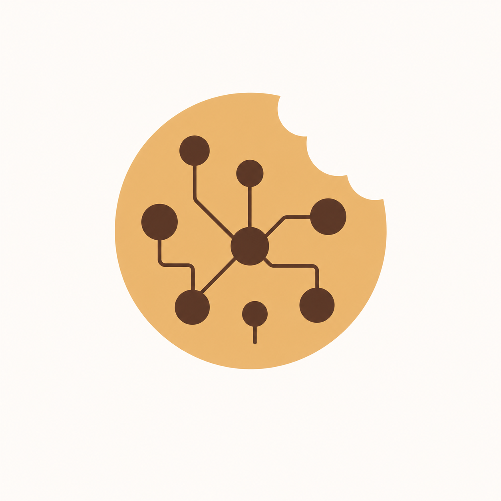

# cookie agent

<p align="center"></p>

Simple and mighty coding agent.

[](https://cookie-agent.github.io/doc/)

cookie agent is a Rust-powered terminal coding agent. The surface stays
minimalistic — a daemon, a TUI, a headless runner — while the batteries are
included underneath: providers, permissions, delegation, sessions, plugins,
and observability are all built in.

## Highlights

- **Subagent delegation** — agents delegate to other agents, with background
  tasks that keep running while you keep working.
- **Runtimes** — a session's tools run in attachable runtimes: the local
  workspace, a repository on another machine over ssh, or several at once,
  with colliding tool names prefixed by runtime.
- **MCP servers** — attach local or remote MCP tool servers, including
  streamable HTTP servers with OAuth, on the daemon or inside a runtime.
- **Plugins** — run out-of-process JSON-RPC extensions that add tools, observe
  events, and intercept decisions across the run lifecycle: user input, model
  requests, tool calls, agent starts, compaction, forks, and more. An official
  Rust SDK (`cookie_agent_plugin_sdk`) handles the protocol for you.
- **Permissions** — every capability is opt-in, and unmatched checks deny by
  default. Agents see only the tools their permission map allows or asks for,
  with resource-pattern rules and allow/ask/deny effects.
- **Agent documents** — Markdown files with YAML frontmatter define personas,
  models, and permissions. Author your own or use the built-in `default`.
- **Skill loading** — strict user/project `SKILL.md` discovery, permission-aware
  model and user invocation, turn-scoped tool grants, and forked skill context.
- **Observability** — per-session token usage, prompt-cache hit rates, and
  estimated cost rollups.
- **Headless runs** — `cookie run` executes a prompt without the TUI, suitable
  for CI and scripting.
- **Durable sessions** — versionless persisted history with best-effort reading
  and automatic context compaction.

## Quick start

Install the latest release on Linux or macOS:

```sh
curl --proto '=https' --tlsv1.2 -LsSf https://github.com/cookie-agent/cookie-agent/releases/latest/download/cookie_agent-installer.sh | sh
```

On Windows, use PowerShell:

```powershell
powershell -ExecutionPolicy Bypass -c "irm https://github.com/cookie-agent/cookie-agent/releases/latest/download/cookie_agent-installer.ps1 | iex"
```

See the [installation guide](https://cookie-agent.github.io/doc/latest/install/)
for direct binary downloads, nightly builds, configuration, and the first run.
Running `cookie` starts a local daemon and opens the TUI. In the TUI, type
`/connect` to store a provider connection, then start a session.

```sh
cookie
```

For headless use:

```sh
cookie run "Review this workspace"
```

## Documentation

Setup, configuration, and task-oriented guides are at
[cookie-agent.github.io/doc](https://cookie-agent.github.io/doc/),
including the development version's [Installation](https://cookie-agent.github.io/doc/dev/install/),
[Run](https://cookie-agent.github.io/doc/dev/guide/run/),
[Development](https://cookie-agent.github.io/doc/dev/development/building/),
[Providers](https://cookie-agent.github.io/doc/dev/guide/providers/),
[Plugins](https://cookie-agent.github.io/doc/dev/guide/plugins/), and
[Agent permissions](https://cookie-agent.github.io/doc/dev/guide/agents/#permissions).

## License

cookie agent is licensed under the [Cookie Agent License](LICENSE): the Apache
License 2.0 with one added condition. You can use, modify, fork, and self-host
it for free, including commercially and as an internal tool for your team. The
exception: an organization with annual revenue of USD 10,000 or more needs a
commercial license to offer cookie agent (its daemon, gateway, or runtime, or a
product that embeds them) to third parties as a hosted service. Contact
realquantumcookie@gmail.com for one.

By submitting a contribution, you agree to the contribution terms in the
license, which let the project owner include your contribution in commercial
licenses.

The `cookie_agent_identity`, `cookie_agent_protocol`, and
`cookie_agent_plugin_sdk` crates are licensed under the standard
[Apache License 2.0](LICENSE-APACHE), so plugins, clients, and runtimes that
speak the protocol can be built and distributed under any terms. Releases
published before 2026-10-16 remain under the MIT License.
