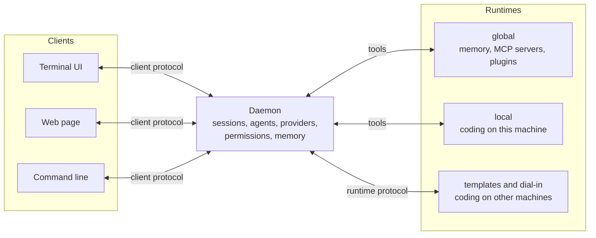

# cookie agent

cookie agent is a subagent-first coding harness. A daemon owns your provider
connections, sessions, agents, permissions, and memory, and runs the models.
Runtimes give its sessions their tools: the files and shell of a workspace on
this machine or another one. Clients, the terminal UI, the web page, and the
command line, all speak one versioned protocol to the daemon, so several of
them can work in the same session at once.



[Concepts](concepts/daemon.md) explains each piece, and
[Architecture](architecture.md) shows how the code implements them.

## Three ways to start

**Just run it in a project.** [Install](install.md) cookie, change to the
repository, and run `cookie`. With no daemon running it starts one inside the
process, opens the terminal UI, and works on that directory. The
[quickstart](quickstart.md) walks through a first session.

```sh
cd ~/src/my-project
cookie
```

**Keep a daemon running.** `cookie daemon` serves its sessions until you stop
it, for example as a service. A plain `cookie` in any directory on the same
machine then opens the terminal UI on it, and `cookie web --open` opens the
same sessions in a browser once the page's origin is allowed. See
[Persistent daemon](daemon/persistent.md) and [Web](clients/web.md).

```sh
cookie daemon          # in one terminal, or as a service
cookie                 # in any project: the TUI on that daemon
cookie web --open      # the browser client, with the token
```

**Use tools on another machine.** A `[runtimes.<id>]` template starts
`cookie runtime serve --stdio` on another machine over ssh, so a session can
read, edit, and run commands in a repository there; or that machine dials in
with `cookie runtime serve --daemon`. See [Runtimes](daemon/runtimes.md).

```toml
[runtimes.labpc]
command = ["ssh", "-o", "BatchMode=yes", "labpc", "cookie", "runtime", "serve", "--stdio"]
```

!!! warning "Keep credentials out of Git"
    Prefer `/connect` or `${env:NAME}` interpolation. Do not commit `.env`, a
    credential-bearing config, or provider-store data.

## Where to go next

- **[Get started](quickstart.md):** install, then a first session end to end.
- **[Concepts](concepts/daemon.md):** the daemon, clients, runtimes, machines,
  sessions, agents, permissions, and memory, and how they relate.
- **Clients:** the [terminal UI](clients/tui.md), the [web page](clients/web.md),
  and the [command line](clients/cli.md), with every command.
- **Run a daemon:** [as its own process](daemon/persistent.md),
  [reached from elsewhere](daemon/remote-access.md), with
  [runtimes](daemon/runtimes.md), and its [security](daemon/security.md)
  boundaries.
- **[Working with sessions](sessions/index.md):** media, compaction, goal mode,
  memory, and usage.
- **Extend:** [agents and presets](extend/agents.md), [skills](extend/skills.md),
  [providers](extend/providers.md), [MCP servers](extend/mcp.md), and
  [plugins](extend/plugins.md).
- **[Configuration](engine/configuration.md):** every key of `config.toml` and
  `tui.toml`.
- **Reference:** [tools](reference/tools.md), the
  [client protocol](reference/protocol.md), [events](reference/events.md),
  [errors](reference/errors.md), and the
  [compatibility](reference/compatibility.md) promise: the client, plugin, and
  runtime protocols and session history are frozen semver surfaces.
- **Build on cookie:** [architecture](architecture.md),
  [building and testing](development/building.md),
  [writing a client](development/clients.md),
  [writing a runtime](development/runtimes.md),
  [plugin development](development/plugins.md), and the
  [Rust API](reference/api.md).
