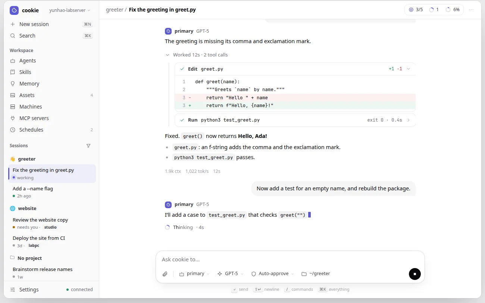
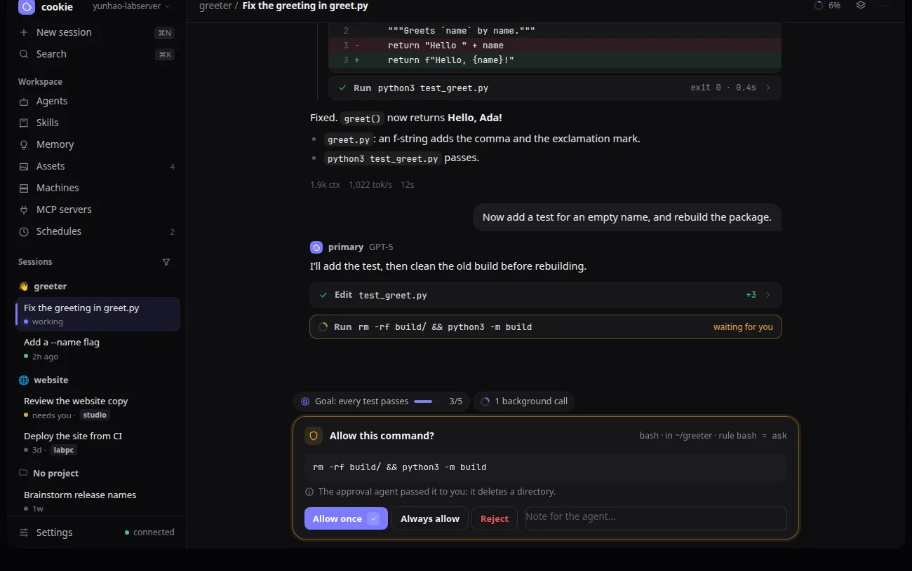
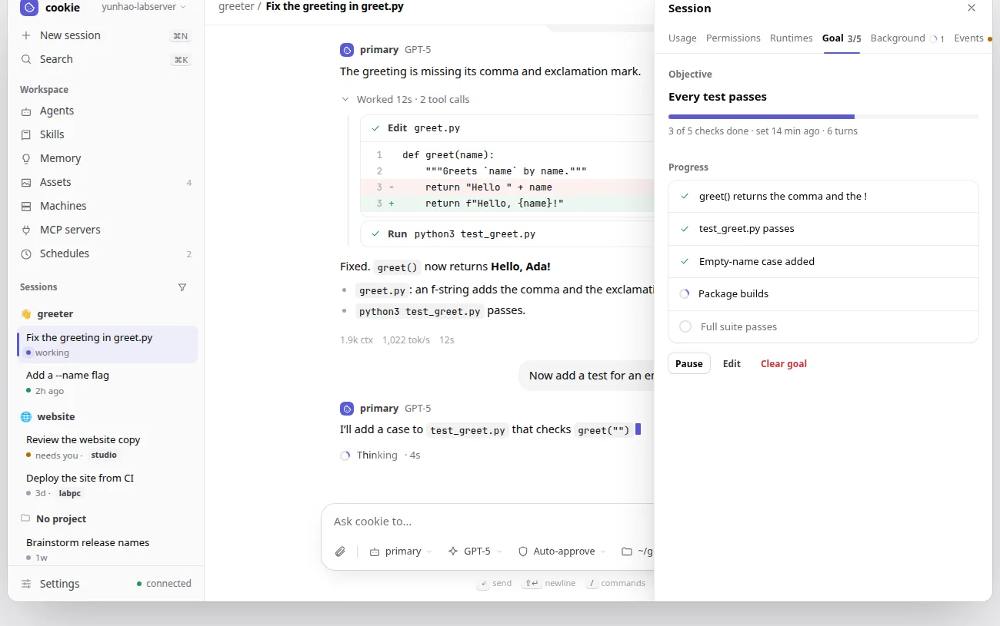
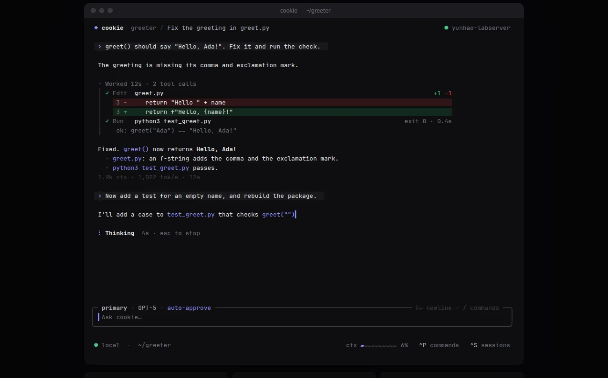
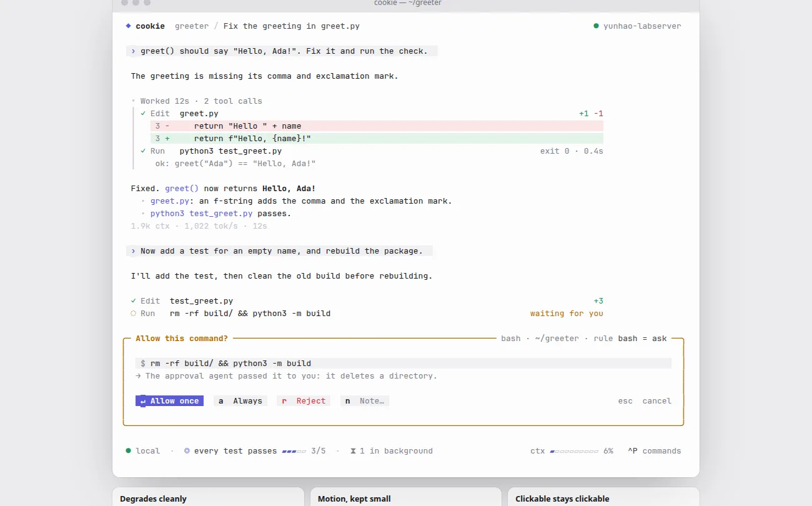

# Quiet Ink: a new look for both clients

Status: **implemented** (2026-11-02), in the phases of
[section 7](#7-phases), with the user's decisions of 2026-11-02 in
[section 2](#2-decisions). Client-only: no client, plugin, or runtime
protocol change, no session history change, no `config.toml` change. One
`tui.toml` change: the `mono` and `high-contrast` themes are removed (D12).

## 1. Goal and scope

**Today** both clients wear the cookie palette: cream, caramel, and
espresso surfaces, a bordered box around nearly everything, an icon rail
beside a session list on the web, and a framed transcript with a doubled
gutter in the TUI.

**This spec** restyles every view of both clients in one design, *Quiet
Ink*: neutral greys, one indigo accent, hairline dividers instead of boxes,
a floating composer, and a little motion where something is live. It also
reshapes a few surfaces (one sidebar, a session panel, live header badges,
menus at their chips, the approval in the composer's place) without
changing what any of them can do.

Out of scope: the landing site and the documentation theme, which keep
the cookie palette for now (D13); features, keys, and commands, which stay
as they are.

## 2. Decisions

**Decided 2026-11-02**, after an inspiration board of three directions
and an interactive preview of the chosen one:

- **D1, direction.** Quiet Ink (direction A), with the floating composer
  and 720 px reading width of direction B and the motion of direction C in
  small doses: a pulse on live sessions, a shimmer on the working label,
  springy menus and sheets. Light and dark are equals.
- **D2, scope.** Every view of the web client and the TUI.
- **D3, one sidebar (web).** The icon rail and the session list merge:
  New session and Search at the top, the views under *Workspace* (Agents,
  Skills, Memory, Assets, Machines, MCP servers, Schedules), then the
  sessions by project, then Settings and the connection at the bottom.
- **D4, no command palette.** The ⌘K palette is not built. The Session
  commands sheet (the header's ⋮) and the session list's search stay,
  restyled.
- **D5, a session panel (web).** Usage, Permissions, Runtimes, Goal,
  Background, and Events become tabs of one right-hand *Session* sheet
  instead of six sheets. Each tab shows what its sheet shows today. The
  Session commands sheet's entries open the panel at their tab.
- **D6, live header badges.** The session header shows what is live: the
  goal (`◎ 3/5`, finished items of the checklist, paused shown as such),
  background calls running (spinner and count), approvals waiting (amber),
  and the context ring, always. A badge appears when its state starts,
  follows it, and leaves when it ends; clicking one opens the session panel
  at its tab. The panel's tabs carry the same counts. In the TUI the same
  parts join the status line, each only while active, and open the goal
  detail and background panel when clicked.
- **D7, menus at their chips.** On a desktop the composer's agent, model,
  and permission mode chips open small menus anchored to the chip instead
  of full-height sheets; on a phone they are bottom sheets.
- **D8, the approval takes the composer's place**, in both clients, until
  it is answered.
- **D9, the TUI without frames.** No box around the transcript and no
  `‖` gutter. The composer is the one rounded box, with the agent, model,
  and mode in its top edge (clickable as today). The status line is plain
  text and key hints.
- **D10, accent.** Indigo: `#5b5bd6` on light, `#7c7cff` on dark.
- **D11, type.** Inter for the web's interface, bundled (variable woff2,
  Latin subset, OFL-1.1, credited in the third-party notices); JetBrains
  Mono stays for code, paths, and numbers in tables. Labels such as
  `primary · GPT-5` move from monospace to the sans.
- **D12, two TUI themes removed.** `theme = "mono"` and
  `theme = "high-contrast"` (and the same `COOKIE_THEME` values) go away;
  `tui.toml` accepts `auto`, `default`, and `dark`, and the removed values
  fail as unknown strings do. `NO_COLOR` and `TERM=dumb` keep working: they
  drop the colour depth to none on the selected light or dark theme, which
  then shows state by bold, italic, underline, and reverse only.
- **D14, Back on a phone (added 2026-11-02).** Android's Back gesture and
  button, and a browser's Back, step back through the page instead of
  leaving it: an open menu, sheet, dialog, or the session panel closes
  first, then an editor or a Settings section, then the drawer, then a
  view other than the conversation returns to it. Only Back from the
  conversation with nothing open leaves the installed app. The page's
  existing history layers (`workspace/nav.rs`) grow to cover these.
- **D15, right-click on a desktop (added 2026-11-02).** With a mouse or
  trackpad, right-clicking anything that has actions opens them as a
  context menu at the pointer: the same actions as its ⋮ button or a
  touch long press (session rows, project headers, messages, agents,
  memories, assets, runtimes, schedules). One menu component serves them
  all, closes on Escape, a click outside, or Back (D14), and takes the
  arrow keys. The browser's own menu stays where it is the useful one:
  over selected text, links, text fields, and code, and with Shift held.
- **D13, the site stays.** The landing site and the documentation theme
  keep the cookie palette for now; only the client screenshots they show
  are refreshed.

The [interactive preview](quiet-ink/preview.html) shows every screen in
both themes (the web's and the TUI's, with a switch for each); it is the
reference for what the phases build, with these exceptions decided after
it: no command palette (D4), the back and right-click behaviour (D14,
D15).

## 3. Tokens

The web's palette becomes semantic tokens that switch with the `dark`
class, so a class names a role once (`bg-raised`) instead of a light and a
dark colour (`bg-toasted dark:bg-ember`). The TUI's `Palette` tables take
the same values.

| Token | Light | Dark | Role |
|---|---|---|---|
| `bg` | `#ffffff` | `#0e0e10` | page, transcript |
| `bg2` | `#fafafa` | `#0a0a0c` | sidebar, editors |
| `raised` | `#ffffff` | `#17171a` | cards, menus, sheets |
| `sunken` | `#f4f4f5` | `#1b1b1f` | user bubble, inputs' fill, code |
| `fg` | `#09090b` | `#ededef` | text |
| `fg2` | `#3f3f46` | `#b4b4bc` | secondary text |
| `muted` | `#71717a` | `#86868f` | meta, placeholders |
| `faint` | `#a1a1aa` | `#5c5c66` | line numbers, separators |
| `line` / `line2` | 7.5 % / 13 % black | 7 % / 12 % white | hairlines |
| `accent` | `#5b5bd6` | `#7c7cff` | the one accent |
| `ok`, `bad`, `warn` | `#26935f`, `#d1343b`, `#b26b00` | `#4cc38a`, `#f2555a`, `#e5a93b` | states, each with a soft tint |

The machine badges' eight hues stay. Every foreground keeps WCAG AA on its
surface, and no state is shown by colour alone.

Type scale 12 / 12.5 / 13.5 / 14.5 / 22 px; radii 6 / 8 / 10 / 12 / 18 px;
three shadows (small, menu, sheet). Motion: 120–300 ms with one ease-out
curve; every animation stops under `prefers-reduced-motion`.

## 4. Web

- **Shell (D3).** One 256 px sidebar. The session list keeps its project
  sections, pins, unread bubbles, machine badges, select mode, search, and
  filter (the filter and search move into the *Sessions* heading's row).
  Live sessions pulse; the selected row has a tint and an accent bar.
- **Session header.** Breadcrumb (project / title), the badges of D6, and
  ⋮ for the Session commands sheet.
- **Transcript.** User turns are grey bubbles; agent turns open with the
  agent and model in the sans. The reduced mode's fold reads `Worked 12s ·
  2 tool calls` and opens onto a thin timeline of tool rows. Tool rows are
  one line (status, verb, argument, `+n −n` or exit code) and open with a
  height transition; diffs use soft tints. The pinned rows (system prompt,
  tools) become small pills. Turn stats are quiet text; copy, revert, and
  fork show on hover.
- **Composer.** One floating card, 18 px corners, with attachments and the
  agent, model, mode, and folder chips inside; the send button becomes stop
  while a run goes. While an approval waits (D8) it is replaced by the
  approval card: command, where it runs and the rule that asked, the
  reviewer's reason, Allow once, Always allow, Reject, and a note.
- **Session panel (D5)** and **chip menus (D7)** as decided.
- **Views.** Agents and Memory as list and editor; Skills grouped into
  official and the user's; Assets as a preview grid; Machines as one panel
  per machine with its runtimes as rows (no cards inside cards); Schedules
  as rows with the schedule in words over its cron line, a pause switch,
  and recent runs; Settings with its own side list and grouped panels;
  every empty state an icon, one sentence, and an action. Onboarding and
  Connect are centred cards on a soft accent glow.
- **Phone.** The sidebar is a drawer; menus and the session panel are
  bottom sheets. Back steps out of the innermost open thing first
  (D14).

## 5. TUI

- `ThemeKind::Default` and `ThemeKind::Dark` take the tokens of section 3,
  quantized to ANSI-256 and ANSI-16 as today. `ThemeKind::Mono`,
  `ThemeKind::HighContrast`, and their branches in `theme.rs` go (D12);
  `ColorLevel::None` keeps the no-colour rendering. The theme reference
  (`docs/site/tui/theme.md`) and the `tui.toml` tests follow.
- **Session view (D9).** A one-line header (`◆ cookie  project / title`
  and the machine); user turns on a raised band with an accent `›`; tool
  calls on a `│` timeline under the reduced fold; diffs with tinted rows;
  the working line a braille spinner and a pulsing `Thinking`.
- **Composer and status line.** The rounded composer box with agent,
  model, and mode in its top edge; below it the status line: connection
  and workspace, then the goal and background parts of D6 while active,
  then context and key hints on the right. The goal and background bars
  (`render_goal_bar`, `render_background_bar`) become those parts.
- **Approval (D8).** A box in the warning colour in the composer's place,
  with the command on a raised row and its answers as key caps.
- **Overlays and panels.** Pickers and panels float on a raised surface
  over the dimmed screen; the selected row gets a tint and an accent `▍`;
  the management panels share one tab strip with an underline.
- Every click target keeps its `PointerTarget` and visible hover; new ones
  (the status line's goal and background parts) get both, per `AGENTS.md`.

## 6. What does not change

The protocol, the reducer, every key binding and command, what each view
can do, the transcript modes, and the tests' rule against pinning looks.
Tests change only where structure changes: which rows and regions exist,
what opens what, and the new pointer targets.

## 7. Phases

Each phase is looked at in light and dark (`scripts/web-screenshots.sh
--all`, the TUI's `render_preview`) before its commit.

1. **Tokens and fonts.** Web: semantic tokens, every class migrated, Inter
   bundled. TUI: the new palette tables, the two themes removed. The layout
   stays as it is.
2. **Web shell.** The one sidebar, the session header with its badges, the
   session panel, and the context menu of D15 on the sidebar's rows.
3. **Web session.** Transcript, composer, approval card, chip menus, and
   the context menu on messages.
4. **Web views and phone.** Every other view, onboarding, connect, the
   phone layout, and Back (D14).
5. **TUI session.** Frames removed, the composer's edge, the status line
   with its live parts, the approval box.
6. **TUI overlays and panels.**
7. **Pictures and docs.** The bundled screenshots, the landing page's
   client pictures, and user docs that describe the old rail or sheets.

## 8. Implementation notes

- **Phase 1 (2026-11-02).** The web's colours are semantic tokens
  (`--qi-*` custom properties, switched by `.dark`, exposed to Tailwind
  through `@theme inline`); a class pair such as `bg-toasted
  dark:bg-ember` became `bg-sunken`. Inter ships as one variable woff2
  subset to Latin (116 KB), credited in Settings › About and the
  third-party notices. The TUI's palette tables are by role (`surface`,
  `sunken`, `line`, `fg`, `muted`, `accent`, …) instead of by bakery hue;
  without colour, `semantic` keeps `DIM` so quiet roles stay quieter.
- **Phase 2 (2026-11-02).** Beyond the decisions: the icons moved from
  Font Awesome's solid set to Lucide's outlines (ISC), drawn at a 1.75
  stroke, with Font Awesome kept for the brand logos Lucide lacks; Agents'
  list stopped borrowing the sessions' sidebar and became a first-level
  list like Memory's; the sidebar button carries the unread dot the rail's
  Chat button had. Back's history layers are `View`, `Section`, `Editor`,
  `Sidebar`, and `Panel`, outermost first. The session panel's tabs open
  their sheets through the commands the ⋮ menu runs, so each reads what it
  shows. Browser scenarios that pinned the rail's layout were rewritten as
  short checks of the sidebar and Back, or dropped.
- **Phase 3 (2026-11-02).** The composer is one card: the text, then a row
  of the attach buttons, the agent, model, mode, folder, and cost chips
  (the bottom bar's, folded in), and the actions; the scrollbar gutter the
  buttons used to dodge went with it. A waiting approval replaces the
  card (`ApprovalDock`, the oldest approval and how many more wait), and
  the phone's separate approvals line is gone. The agent, model, and mode
  pickers keep their sheet (`#sheet`) but draw it as a menu over their
  chip on wider windows (`data-anchored`). Replies' headers are the
  agent's name, then its model, in the sans; tool rows are raised cards
  on a hairline ring; the transcript and the composer share the 720 px
  column.
- **Phase 4 (2026-11-02).** Buttons, fields, rows, panels, confirmations,
  and empty states restyle through their shared constants and a pass over
  the remaining bordered boxes; Settings' list has icons, with each
  section's note on a phone only. Back reaches every small overlay through
  one `Transient` layer that a row's menu, a context menu, and the media
  viewer register their close with. Right-click menus cover memories,
  schedules, assets, the agents panel's rows, runtimes, and your messages
  (their message menu). On a phone the sidebar's views are a four-column
  grid of tiles, so the sessions keep their room.
- **Phases 5 and 6 (2026-11-02).** The conversation pane keeps its
  one-cell margin but draws no frame: the top row is a header (the
  session's title; the events filter and the scrolled note on the right),
  so every geometry and hit region stays put. Replies' `│` gutter is a
  hairline (`Theme::gutter`); the user's keeps the accent. The goal bar
  leads with `◎` and its checklist's progress, the background bar with
  `⧗`; they stay their own rows rather than joining the status line,
  whose width-fitting already spends the row. The status line's mode is
  the accent, its hint `ctrl+p commands`. Every modal and the command
  palette dim the screen behind them (`Theme::dimmed`, a blend toward the
  surface in true colour, `DIM` elsewhere).
- **Phase 7 (2026-11-02).** The install manifest's screenshots show the
  new look; the landing page keeps its pictures (D13). Below desktop
  widths every control keeps a finger's 44 px, since tablets take touch
  too; only a desktop's are 36 px.
